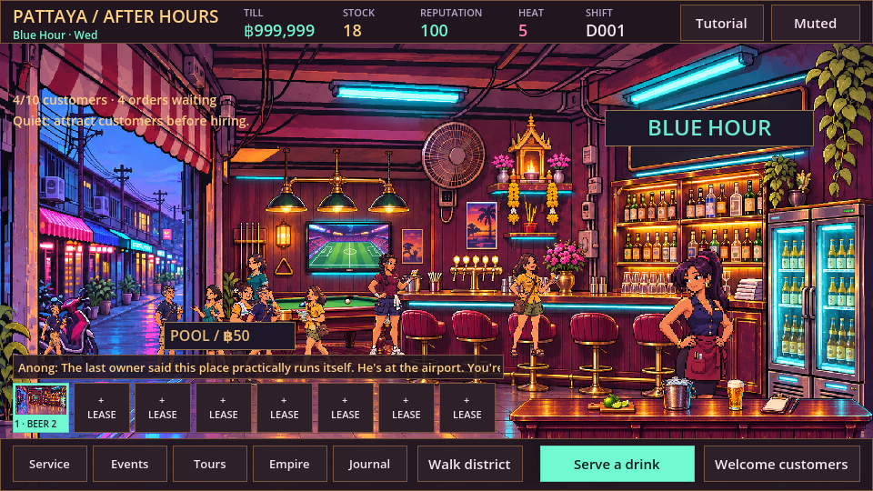
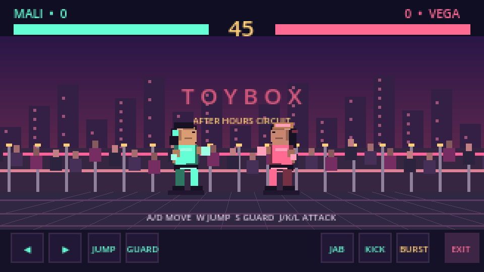

# Pattaya After Hours

Run the Blue Hour in a fictional neon harbor district. Anong wants a payroll reserve, Toybox just let out, and someone ordered four hundred limes.

**[Get it on Obtainium](https://apps.obtainium.imranr.dev/redirect?r=obtainium%3A%2F%2Fapp%2F%257B%2522id%2522%253A%2522io.github.rknell.pattayaafterhours%2522%252C%2522url%2522%253A%2522https%253A%252F%252Fgithub.com%252Frknell%252Fpattaya-after-hours%2522%252C%2522author%2522%253A%2522rknell%2522%252C%2522name%2522%253A%2522Pattaya%2520After%2520Hours%2522%257D)** · **[Android APK](https://github.com/rknell/pattaya-after-hours/releases/latest/download/PattayaAfterHours.apk)** · **[Desktop downloads](https://github.com/rknell/pattaya-after-hours/releases/latest)**



## Play

Incident responses show the odds and effects of both outcomes. After choosing, look beneath the map for the result and the last wave’s sales or bottleneck. The closeout keeps the decisions for the whole shift.

Select **Tutorial** at the top of the game to run a short practice shift. Learn to restock, make service decisions, and read the closeout. You can exit or replay it any time without changing your campaign.

- **Service.** Set the schedule, buy stock, pick a promotion, and split the rota. Work through early service, the rush, and last call. Review closing figures and Tuesday's rent, payroll, permits, and outstanding bills.
- **The district.** Walk the bay, market, harbor, and promenade as scooters and pickups pass. Weather affects foot traffic, guide bookings, and power bills.
- **Tours and events.** Book paid, voluntary short and long tours. Host Toybox Muay Thai, live music, a theme night, or a football screening. Forecasts, capacity, delays, and door cover affect turnout.
- **The campaign.** Play through the Blue Hour's first year and its 51 incident cards and 15 scheduled story beats. Co-owner Anong has a say in the reserve, family commitments, paperwork, and expansion. Endings reflect the shape of the business and the partnership.
- **Godzilla test encounter.** Open the Blue Hour on day 3. Tap **Serve a shot** or press **Space** to fill the intoxication meter within ten seconds. A win leaves Godzilla asleep outside until the next day. A timeout costs the night’s bar sales.
- **Expansion.** Train and hire staff, renovate, add a food counter, lease a second venue, or manage a volatile mining rig. Work with licensed security, local contacts, and fictional competitors. All transactions use in-game money.
- **Toybox arcade.** Play Mali in best-of-three bouts with jabs, kicks, jumps, guards, a chargeable Burst, and three opponents. Head to Events for sparring or the full circuit. Campaign bouts change the shift budget, reputation, and staff availability.



The game plays offline and autosaves after decisions, including during a shift. A campaign fight resumes at the start of the bout.

| Where | Controls |
| --- | --- |
| Management | Click or tap the controls. Scroll the right panel for the full rota and options. |
| District | WASD or arrow keys to walk, E to enter, Esc to return. On touch, tap a spot to walk there or a location to enter it. |
| Toybox | A/D or arrows to move, W/Up to jump, S/Down to guard, J to jab, K to kick, L to Burst, and Esc to exit. Android has on-screen multitouch controls. |

## Install

- **Android.** Use the Obtainium button, or add `https://github.com/rknell/pattaya-after-hours` as the source in Obtainium. The signed APK supports Android 7.0 and later on ARM64 and x86-64. Package ID is `io.github.rknell.pattayaafterhours`.
- **Linux x86-64.** Extract the ZIP and run `PattayaAfterHours.x86_64`.
- **Windows x86-64.** Extract the ZIP and run `PattayaAfterHours.exe`. The executable is unsigned.
- **macOS Intel and Apple Silicon.** Extract the ZIP and open the app. The build is ad-hoc signed and has no Apple notarization.

APK signing certificate SHA-256

`4a72524dbe76197f4c5122f0f99c6967f7c969ac978fcae37d48dbd6432827c0`

## Build from source

Open `project.godot` in Godot **4.7.2** and press F5. Install matching export templates for release builds.

```sh
GODOT_BIN=/path/to/godot tools/test.sh
GODOT_BIN=/path/to/godot tools/release.sh
```

For a signed Android export, set `ANDROID_HOME`, `JAVA_HOME`, `GODOT_ANDROID_KEYSTORE_RELEASE_PATH`, `GODOT_ANDROID_KEYSTORE_RELEASE_USER`, and `GODOT_ANDROID_KEYSTORE_RELEASE_PASSWORD`. Keep the same signing key and increase Android's `version/code` for each published update. The script writes packages and checksums to `dist/`.

The streets, businesses, characters, artwork, and arcade moves are original fictional content. The game and original assets are [MIT licensed](LICENSE). Godot and the bundled [DejaVu font](assets/DejaVu-LICENSE.txt) have their own notices.
