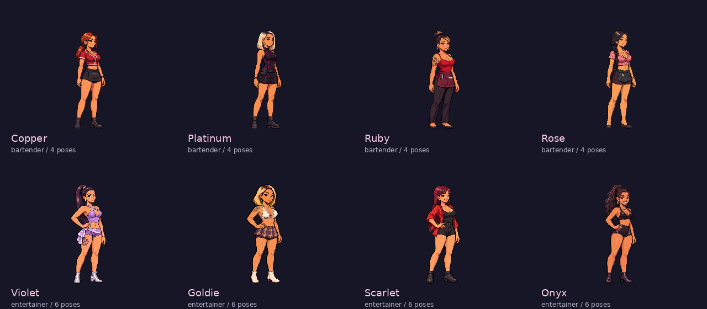

# Bar staff sprite pack v1

Eight original fictional adults inspired by the user's supplied nightlife
reference boards, generated with built-in ImageGen on 27 November 2026.
Dao's existing sprite supplied the rendering style. Reference photos, names,
logos and advertising copy are not included in the pack. The nicknames below
are working art identifiers, not additions to the story or hiring roster.



| Character | Role | Design | Frames |
| --- | --- | --- | --- |
| Copper | Bartender | Copper ponytail, red cropped shirt, black apron/shorts | 4 |
| Platinum | Bartender | Blonde bob, black dress with magenta piping | 4 |
| Ruby | Bartender | High bun, red camisole, burgundy apron, floral arm tattoo | 4 |
| Rose | Bartender | Dark braid, pink blouse, plum shorts | 4 |
| Violet | Entertainer | Long ponytail, lavender performance outfit, silver boots | 6 |
| Goldie | Entertainer | Honey-blonde bob, white halter, plum/gold plaid | 6 |
| Scarlet | Entertainer | Burgundy hair, red jacket, black stage outfit | 6 |
| Onyx | Entertainer | Curly ponytail, black/violet stage outfit, silver jewellery | 6 |

## Files and compatibility

- `sources/`: eight full-resolution generated sheets, retained without edits.
- `atlases/`: eight transparent, single-row PNG atlases; 40 poses total.
- `portraits/`: eight transparent 96×96 portrait crops.
- [manifest.json](manifest.json): frame order, rectangles, pivots, animation
  mappings, source cuts, portrait crops and SHA-256 hashes.
- [recipes.json](recipes.json): exact initial/edit prompts, reference roles and
  generation receipts. The built-in tool exposed no seed or model version.
- [pose-review.png](pose-review.png): every packed pose on light/dark backgrounds.
- [engine-preview.png](engine-preview.png): all identities and portraits in Godot.
- [pose-cycle.gif](pose-cycle.gif): a sequence of the in-engine pose captures.

Bartenders use **160×192** cells in `idle / walk-a / walk-b / serve` order,
matching Gabby's animation indices. Entertainers use **160×256** cells in
`idle / greeting / dance-a / dance-b / walk-a / walk-b` order, matching Daisy's
indices. Each atlas uses one shared scale for all its character's poses, a
supporting-foot centre pivot, and four transparent pixels below the feet.
The existing alpha cutoff of 160 and nearest-neighbour resizing are used.
There are two authored walk/dance key poses, rather than a full directional
locomotion cycle. No pole interactions or rear/front walking sheets are included.

This directory is **authoring-only**, excluded from game imports/exports by
`art/.gdignore`. The pack does not change production characters, the runtime
manifest, staff IDs, hiring, contracts, saves, budgets or service logic.
To integrate a selected character, copy its atlas/portrait into `assets/art/`,
register the catalog entries and stable identity, and retain model-owned role,
availability and real-sale animation triggers. The entertainer greeting/carry
index is presentation art, not an ability to serve ordinary orders.

## Rebuild and review

```sh
python3 tools/prepare_staff_pack.py
PATTAYA_PREVIEW_SCRIPT=tests/preview_staff_pack.gd tools/preview-art.sh /tmp/pattaya-staff-pack-preview
```

The packer only writes this pack. It fails on empty/clipped cells and retains
the source alpha. The isolated Godot preview loads these files directly for
review without starting a campaign or adding decorative staff to a live venue.
The PNGs have real alpha; some source viewers can display RGB colour stored
under transparent pixels. The packed edge sheet shows their actual composition.

Verification results are recorded in [verification.json](verification.json).
Live hiring/venue integration and device play are not part of this art pack.
