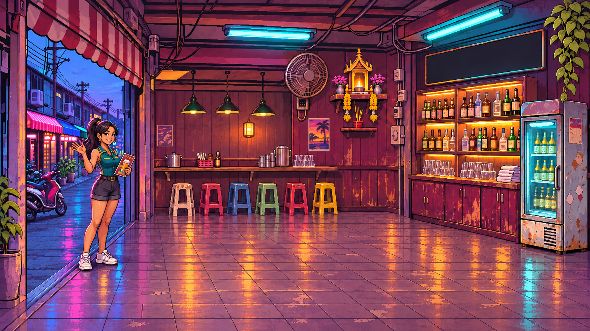

# More room, six-packs and a face out front

**Status: implemented in `codex/promoter-implementation`, including schema-six
migration and production artwork. The design below retains its original
analytical examples; current rules and measured campaign outcomes are in
[ECONOMY.md](../ECONOMY.md) and [TESTING.md](../TESTING.md).**

Requested and confirmed on 25 November 2026: a third stage-1 beer-bar seating
upgrade must hold **12 customers with the pool table and fans installed**;
restocking buys complete six-packs; an adult promoter costs **฿1,200 per ten-day
contract plus 10% of all venue drink sales while on duty**. Promoters and dancers
gain stage-gated training. This plan builds on source `0d7bb90`, including the
TV/patience fix, included in the same implementation/release branch.

## The intended experience

Anong: “She can get them through the door. You still have to get them a drink.”

The owner first learns to serve, then chooses whether the next investment should
bring visitors, fit them comfortably or serve them faster. Hiring a promoter
replaces repeated Welcome taps and leaves the owner free to pour and chat.
Buying twelve places does not fill them. Hiring a promoter does not fulfil orders.
Six-packs make stocking a readable cash-and-space decision.

Keep the existing targets: useful purchase at 2–5 minutes, pool at 10–20,
stage 2 at 30–45, second property at 90–150 and stage 3 at 180–300 active minutes.
These remain acceptance windows, not new waiting timers. Do not raise renovation
prices automatically to offset the feature.

## 1. Third seating upgrade: compact layout

Keep the first two prices and add a third beer-bar-only purchase:

| Seating level | Incremental cost | Empty-room capacity, stage 1 | With one pool table and comfort |
| --- | ---: | ---: | ---: |
| 0 | — | 6 | 3 |
| 1 | ฿400 | 8 | 5 |
| 2 | ฿800 | 10 | 7 |
| 3: Compact layout | ฿1,200 | **12** | **12** |

The final purchase adds two places and reorganises furniture to recover up to
three places lost to the first pool table/comfort upgrade. Use wall benches and
compact tables as the visual explanation. It is not a hidden renovation and
does not grant free pool or comfort equipment. Total seating investment is ฿2,400.

Proposed beer-bar formula:

`base_stage_seats + 2 × seating_level − furniture_loss + layout_recovery`

`furniture_loss = 2 × pool_tables + comfort_level`

`layout_recovery = min(3, furniture_loss)` only when seating level is 3; otherwise 0.

This reaches twelve with any permitted stage-1 furniture combination. The layout
persists through renovation: stage 2 reaches eighteen with one pool table and
comfort, sixteen with two tables and comfort. Stage 3 reaches twenty-six or
twenty-four respectively. The second pool table still costs space. Soi/gogo
seating caps remain two levels in this slice. Owned furniture is never refunded,
removed or granted, and existing occupants are never evicted by a purchase.

The button previews actual capacity, e.g. **“Compact layout · ฿1,200 · 7 → 12
customers”**, and still requires the next shift's operating reserve. Costs and
level caps must come from shared equipment rules, not UI-only exceptions.

## 2. Restock exactly six drinks

- One manual **Buy 6 drinks · ฿84** action buys precisely six units at the current
  ฿14 cost. No fill-the-fridge fallback, partial pack or silent smaller purchase.
- Require at least six free spaces and ฿84 cash. Deduct cash and add stock together
  once. Failed attempts change nothing. Manual purchases need no extra hidden
  reserve; show the remaining cash and next operating charge before purchase.
- Fridge capacities remain 30, then +40 per fridge upgrade and +20 per venue
  stage. A 70-unit fridge can legitimately have four unfilled spaces. Do not
  round capacities or discard existing stock to make them multiples of six.
- UI examples: **“Need 6 free spaces; you have 4”**, **“Need ฿84; you have ฿70”**.
  Recheck authoritative stock/cash at activation, not just when enabling a button.
- Supplier automation buys one complete pack when stock is below six and there
  is a pending order, provided there is space and cash for ฿84 plus the next
  operating charge. It does not fill an idle bar speculatively. A later tick can
  buy again under the same rule; no fractional automatic deliveries.
- Update Serve's supplier eligibility: the current one-unit affordability check
  is insufficient once an empty fridge needs a whole pack. Auto-service and manual
  service call the same stock operation. Stock purchases remain ledger expenses.
- Recovery remains possible: Bo's existing six consignment drinks are explicitly
  an emergency loan of stock, not a normal cash purchase. Their costs are deducted
  on sale. Keep this exception so an empty till is recoverable.

Boundary examples: stock 24/30 and cash ฿84 succeeds to 30/30 and ฿0; stock 25/30
fails even with plenty of cash; cash ฿83 fails with an empty fridge; stock 66/70
fails until two more drinks sell. Inventory already saved is untouched.

## 3. Adult promoter: Nida

Nida is a fictional adult, 28, friendly and practical. She likes music nights and
knows when a queue needs calming rather than another invitation. She is a paid
colleague, not a purchasable customer or an automatic bartender.

| Term | Proposed rule |
| --- | --- |
| Hire / rehire | ฿1,200, ten game days / 14,400 game minutes |
| Additional pay | 10% commission on drink receipts; no hourly wage for this role |
| Roster | One dedicated frontage slot per venue; does not consume bartender/host slots or customer seats |
| Eligibility | Available from stage 1; no compulsory hire gate for chapters |
| Work | Attracts existing shared traffic; never serves, stocks, chats or completes host bookings |
| Clock | Existing contract rules: closed, off-duty, skipped and offline time count |
| Expiry | Leaves her post; manual rehire; portrait, identity and training retained |
| Scheduling | Off-duty stops new attraction and new ordinary commission eligibility; existing commitments still settle |
| Purchase reserve | Keep one forecast shift's overhead/wages and one ฿84 pack after hiring |

Append a new role ID rather than renumbering existing roles. The frontage slot is
separate from service capacity and manager prerequisites. No cheap conversion
from a ฿1,200 promoter contract into a ฿4,500 bartender/dancer contract. Dancer
training is a separate track described below.

### Attraction without unlimited customers

Start with a **+4.8 attraction-weight** bonus while contracted, on duty and the
venue is trading. This is a weight in the current shared-street choice model,
not 4.8 guaranteed customers per minute and not a multiplier to drink prices.
It is deliberately stronger than the maximum owner Welcome bonus of +1.2,
because the promoter charges an ongoing share of receipts as well as her fee.

Use `max(owner_welcome_bonus, promoter_bonus)`, not their sum. Welcome displays
**“Nida is welcoming”** while she works; owner Chat remains available using its
own existing social cooldown. Do not reset that cooldown on hire/rota changes.
Existing welcoming upgrades remain owned and apply whenever the owner resumes
the job. Retain signage, regulars, promotional events and venue audience affinities.

At a clean, basic beer bar at noon, the analytical forecast rises from about
3.37 to 4.65 arrivals/minute: roughly 38%, before space, queues and service losses.
The whole street still supplies 7.3 potential visitors/minute in ordinary weather.
Adding properties redistributes visitors and uses the existing distinct-audience
bonus; each promoter must not generate a new private street stream.

### Commission settlement and abuse prevention

Commission applies to actual paid drinks, including discounted/premium drinks,
whether served manually or by staff. It excludes pool fees, bar fines, event
rewards, loans and offline claims already settled. A ฿55 beer yields ฿5.50
commission; a ฿44 Happy Hour drink yields ฿4.40. No order or stock means no sale
and no commission. Never apply the percentage to gross venue revenue indiscriminately.

Keep money integer-valued: save a per-venue percentage remainder. For each
eligible receipt, add `paid_price × 10`, pay whole baht by division by 100 and
retain the remainder. Two ฿55 drinks pay ฿11 total, regardless of reloads, shift
boundaries or roster toggles. Do not erase the remainder when a contract expires.

At settlement, all drink sales while she is on duty are eligible. Also preserve
commitments: customers admitted while she is working carry a visit-long commission
flag, and orders placed by earlier guests while she works retain an order flag.
These flagged sales remain eligible after she is scheduled off or expires. This
prevents switching her off immediately before Serve to keep her attraction but
avoid her pay. Apply **one 10% fee**, never both flags' fees. An old flagged sale
after a rehire still pays only once. Display “Commission still due on existing
visits/orders” when taking her off duty. Unserved/abandoned orders owe nothing.

Record gross drink income and commission separately, with net cash credited
atomically. Include commission in weekly costs, shift net, healthy-shift operating
margin, promotion contribution, forecasts and offline estimates exactly once.
Show actual commission paid and any sub-baht carry; attraction uplift is an estimate.

## 4. Training grows with the venue

| Role | Stage 1 | Stage 2 unlock | Stage 3 unlock |
| --- | --- | --- | --- |
| Promoter | Street welcome: +4.8 weight | Crowd reader: +6.0, training ฿800 | Frontage lead: +7.2, training ฿1,600 |
| Dancer | Existing attraction/show contribution ×1 | Stage presence: ×1.25, training ฿800 | Headline performer: ×1.5, training ฿1,600 |

These are incremental one-time training prices, paid per person. Higher stages
unlock training; they do not grant it. Training persists through expiry/rehire.
Promoter contract and commission stay ฿1,200/10% at every tier. Dancers retain
their current ฿4,500 contracts and ฿36/min on-duty wages; the new 10% commission
belongs only to the frontage promoter and never stacks per dancer.

Dancer training scales only that dancer's existing base/show attraction. Shows
still run during their current shift window. It does not multiply whole-venue
attraction, change other workers, add orders directly or improve service. Store
audience training separately from bartender service training. Old staff retain
their existing skills; initialise the new track at zero with no retroactive cost.

## 5. Balance evidence and the hire preview

The reproducible [calculator](promoter_balance.py) and [results](promoter-balance-estimates.json)
use the current attraction/forecast equations, with the proposed promoter bonus.
They are **analytical steady-trading estimates, not seeded campaign simulations**.
They assume perfect stock, a clean room, two orders per visit and adequate budgets;
they omit real queue abandonment and changing peaks. They cannot prove pacing.

At ฿55 retail and ฿14 stock cost, margin is ฿41 without commission and ฿35.50
with it. To repay a ฿1,200 contract over 130 open minutes, a bar previously selling
six drinks/minute needs approximately **1.19 additional drinks/minute**. The
tempting “34 drinks repay her fee” calculation ignores the commission on preexisting
sales and must not be shown as the hire's break-even claim.

| Example | Sales/min before → after | Incremental margin/min, before hire fee | Hire fee payback in open minutes |
| --- | ---: | ---: | ---: |
| Base ten-second owner, spare seats | 6 → 6 | −฿33.00 | Does not repay |
| Six-second pouring, spare seats, previously no Welcome | 6.73 → 9.30 | +฿54.19 | 22.1 |
| Same owner already welcoming continuously | 7.60 → 9.30 | +฿18.87 | 63.6 |
| Space-limited layout | 4 → 4 | −฿22.00 | Does not repay |
| Base bartender alone | 2.4 → 2.4 | −฿13.20 | Does not repay |
| Established sign/pool venue, base promoter | 8.80 → 10.31 | +฿5.24 | 229.2 |
| Same venue, stage-2 trained promoter | 8.80 → 10.57 | +฿14.47 | 82.9, excluding training |

For that last example, hiring **and** paying ฿800 training takes about 138 open
minutes to recover at the estimated rate; the training persists into later
contracts. The 130-minute term assumes ten complete normal trading days with
overnight skips. Hiring late, closures, longer real absences or different legal
hours changes the available trading time. Do not promise ten full shifts.

The intended choice is conditional, not a mandatory first purchase. Recommend
service/stock first when the owner or a base bartender is the bottleneck. A busy
established venue may not need a base promoter. A competing venue's increased
sales can partly cannibalise the flagship; show street-wide incremental profit
as well as the selected venue's projection.

Before hiring show: upfront ฿1,200, remaining cash, next pack cost, fixed operating
costs, estimated commission/min, arrivals and service capacity before/after,
and incremental net. Distinguish staff-only unattended service from an explicitly
labelled owner-active scenario. State “Service is limiting sales” when applicable.
Actual recent net remains separate from both forecasts. Contract amortisation is
an analysis line, not a second wage charge after paying the fee.

## 6. Frontage art direction

The built-in image generator produced this review concept from the existing room
and staff style references. [Exact prompt and provenance](../../art/recipes/promoter-frontage-v1.json).
It is authoring material, excluded from game exports, not a background replacement.

Nida wears a teal/gold sleeveless collared staff top, tailored dark shorts and
practical white trainers, with a high ponytail, small earrings and a menu flyer.
Her welcoming gesture should read at mobile scale. Keep her distinct from Dao,
Anong, indoor hosts and ordinary passersby. No exaggerated body proportions or
sexualised recruitment animation.

Production work: separate transparent poses for idle, wave, indicate entrance
and brief acknowledge; a portrait; stable foot pivot and nearest-neighbour packing
matching the current catalog. Generate poses individually using this identity,
then review their silhouette at actual game size. The concept enlarges her for
review; it is not an exact engine placement/scale specification.

Initial scene anchor: street-side doorway at approximately (205,365) in the
960×540 room coordinate system, scale about 0.75, adjusted per venue plate after
preview. Keep clear of the passerby lane around x=120–185, indoor customers from
x=240 onward, room status text and property dock. The stage-three beer terrace
needs its own placement review. A standing promoter has no order dot and does
not increase customer count. Hide her on off-duty/expiry/closure; working states
follow the model. Waves are cosmetic, never a second source of arrivals.

Render twelve real guests legibly with staggered positions and unobscured urgency
dots. The compact-layout visual uses benches against the wall, not extra blocking
furniture across the pool aisle. Review all stages and closed/raid/flood states
before adding anything to the production manifest.

## 7. Offline operation, saves and implementation order

1. **Pack operations and seating.** Shared quote/eligibility/settlement operations
   in `economy.gd`, data/caps in `street_content.gd`, and real UI before/after
   previews. Update both manual and automatic stock paths together.
2. **Role and commission.** Add promoter eligibility, contract price/wages by role,
   one frontage slot, stage-gated audience training, persisted visit/order
   commission flags and percentage carry. Use existing contract ageing and
   save-on-action behaviour. All sale paths share settlement.
3. **Forecast and offline parity.** Include audience training, commission, role
   expiry and supplier pack working capital; then expose hire/rota/report UI.
4. **Artwork integration.** Separate character sprites and compact furniture
   overlays; preserve original room plates. Use `city.gd`/`art.gd` only for display.
5. **Combined balancing and release review.** Run the acceptance matrix below,
   update current gameplay docs only when mechanics exist, then hand off for merge.

Offline income keeps the eight-hour cap and manager requirement. A promoter
alone is not an offline manager or bartender. All contracts age across the full
absence; split forecasts at expiry, opening/closing and existing peak boundaries.
Never renew automatically or replay promotions/events. On-duty promoter attraction
and 10% commission use the same coefficients as live trading.

The current offline per-unit stock-cost shortcut is insufficient for six-packs.
Project whole six-unit purchases and integer sales with a saved fractional-sales
carry, split at pack/clock/contract boundaries. Use an isolated projection of stock,
commission carry and newly earned operating cash; commit the resulting estimate
once with the offline watermark. Starting owned stock may be consumed, but the
opening cash balance is protected: pack purchases and operating charges must be
funded by the simulated trading surplus, or projected operation pauses. An empty
fridge with no earned surplus therefore cannot bootstrap an offline pack.
Report this as a stock/working-capital limit, not negative income. Save actual
projected leftover stock; charge the entire pack, not just units sold. Do not
debit stock purchase costs again for inventory already paid for; cost-of-goods
margin may be reported separately from these cash movements. Keep
customer queues, promotions, live calendar and disaster state unchanged.

Plan a schema-6 migration because validators, role IDs and persisted commission
state change. Read older schema-5 campaigns: preserve cash, staff, stages, stock,
training, TV ownership, timers and pool identities. Old seating level 2 stays 2;
the third is a future purchase. Add no free promoter or automatic fee. Old pending
orders start with no historical commission commitment. Preserve fractional fields
explicitly in numeric restoration. Loading alone must remain read-only until Resume.

## 8. Acceptance and tuning gates

- All four seating levels show the stated capacities; the third delivers twelve
  with every stage-1 furniture combination. Other venues keep their caps. Twelve
  visible guests and their warning dots remain readable on mobile landscape.
- Manual packs pass cash ฿83/84/85 and space 5/6/7 boundaries, including odd fridge
  capacities, repeated clicks and reloads. Auto-supply never buys partial packs;
  low-stock Serve eligibility agrees with actual settlement. Recovery works at ฿0.
- An active promoter replaces Welcome effort, does not supply drinks and cannot
  create visitors beyond bounded traffic. Off-duty, closed and expired staff stop
  attracting. Changing rota or rendering twice cannot duplicate welcome effects.
- All eligible drink receipts pay one 10% commission; pool/fines/rewards pay zero.
  Test discounted/premium orders, old quotes, service/rota ordering, contract expiry,
  rehire, save/reload and carry across many small receipts. Existing commitments
  cannot be cancelled by toggles. No negative cash or invisible commission debt.
- Training gates and prices work per person; training survives rehire. Dancers
  improve attraction only. A cheap promoter cannot become a bartender by changing
  role. Existing bartender training and two-stage-1 service slots remain valid.
- Offline whole-pack cash flow, commission carry, contract expiry and caps are
  repeat-safe; splitting an absence into claims does not mint stock or cash.
  Unviable trading pauses while preserving the starting cash reserve.
- Run `tools/test.sh` against fresh campaigns. Keep the existing fifteen policies
  and add promoter-first, service-first, no-promoter, compact-layout-first and
  dancer-training comparisons for seeds 11, 72 and 291. Add varying welcome/Chat
  use, quiet/rush/stockout cases, full rooms, and two competing promoted properties.
- Tune against **incremental street profit**, actual lost orders, regulars, hire
  payback and active milestone windows. Include the six-pack click frequency and
  an unattended base-bartender run; do not hide a service bottleneck with a larger
  attraction bonus. All sensible paths must remain viable; no hire is compulsory.
- Proposed hire target: often worth buying after service improvements during
  stage 1 (roughly 15–30 active minutes), with 30–90 open-minute payback in typical
  suitable campaigns. The optimistic analytical 22-minute result is not that
  acceptance result. If fresh simulations accelerate mandatory milestones below
  target, tune attraction/training before changing the confirmed ฿1,200/10% terms.
- Render actual owned/unowned layouts, on/off/expired promoters, every venue
  type/stage and normal/urgent orders at 960×540 and a wider landscape size.
  Android touch/lifecycle and human pacing checks are separate from exports.

No implementation or public release is implied by committing this plan. Reconcile
the existing TV/patience branch and other contributors before starting the next
gameplay implementation; do not silently take another contributor's active slot.

## Later automation update

The subsequent [economy rules](../ECONOMY.md) extend this implementation with
supplier discounts, music, owner automation and separate manager income.
The fixed ฿84 pack assumption below now describes supplier level zero/one;
higher levels discount future packs. Nida's terms and commission rules persist,
and she now faces toward the street. Current pacing measurements supersede this
plan's original forecasts.

## Implementation record — 25 November 2026

The agreed prices, capacity, commission basis and stage gates are implemented.
Nida uses four production poses plus a portrait; the room uses a separately
generated compact bench prop. Earlier concept images remain authoring references.

Offline operations settle whole drinks and whole packs with fractional estimate
credits saved alongside their costs. Each claim protects its starting cash, so
a fresh claim cannot use an earlier claim's banked profit to bootstrap an empty
fridge. This intentionally conservative detail is exposed in the player guide.

The baseline active pacing windows pass. Optional promoter-first spending delays
stage two to about 47 minutes and can push stage three slightly beyond five
hours; service-first investment is faster. This is documented as a real trade-off,
not hidden by higher baseline income. Dancer training has role/gate/save checks;
a full dancer-versus-bartender gogo campaign comparison is future balance work.
